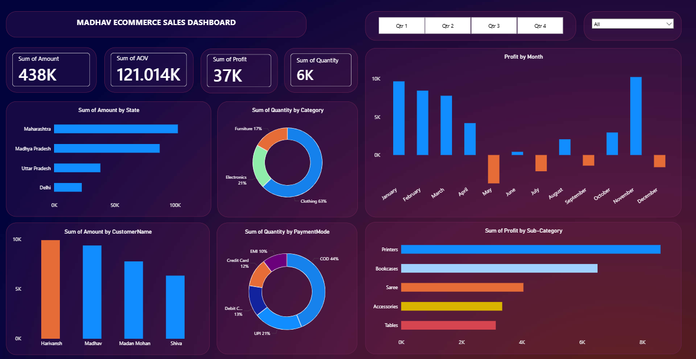

# E-Commerce Sales Analysis Dashboard | Power BI

Project Overview

This project presents an interactive E-Commerce Sales Analysis Dashboard developed using Microsoft Power BI Desktop. It transforms sales data into visual insights to help understand business performance, explore sales trends, and support data-driven decision-making.

Objectives
- Analyze e-commerce sales data.
- Understand sales performance and business trends.
- Explore order and customer-related information.
- Present data through interactive visualizations.
- Make sales information easier to understand.

Tools Used
- Microsoft Power BI Desktop
- Data Analysis
- Data Visualization
- Interactive Dashboard Design

Project Files

- Power BI Dashboard (.pbix): The complete interactive E-Commerce Sales Analysis Dashboard created using Power BI Desktop.
- Orders Dataset: Contains order-related data used for the analysis.
- Details Dataset: Contains additional sales-related data used to build the dashboard.
- Dashboard Preview: Screenshot of the completed Power BI dashboard for a quick visual overview.
- Dark-gradient.jpg: Image asset included in the project files.
 
Dashboard Preview

The dashboard preview is included in this repository. Open the preview image to see the report's visual layout.

How to Use
1. Download the Power BI ".pbix" project file.
2. Open it in Microsoft Power BI Desktop.
3. Explore the report pages, charts, and available filters.

Key Learning Outcomes
- Working with sales datasets.
- Creating interactive dashboards in Power BI.
- Presenting business data through visual reports.
- Developing practical data analysis and business intelligence skills.
